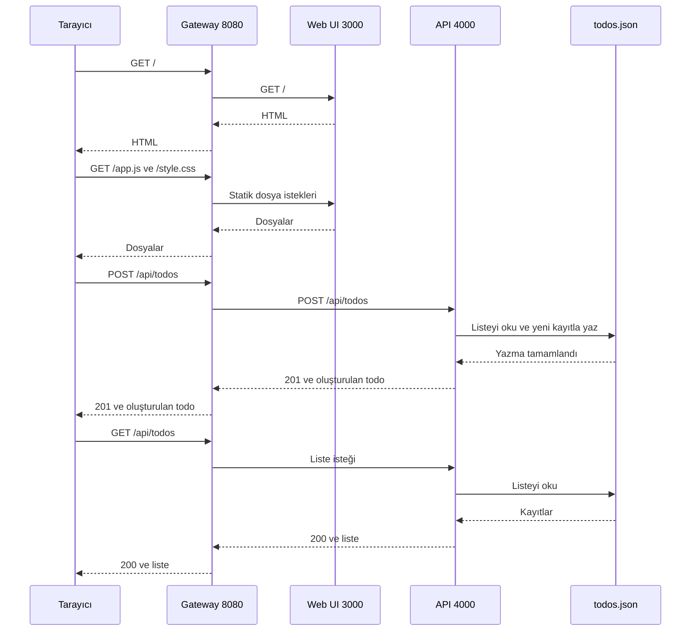

# Go ile Todo API ve Reverse Proxy: Sistemin Çalışma Mantığı

**Tarih:** 23 Ekim 2026  
**Kapsam:** Birlikte geliştirdiğimiz API, Web UI ve gateway uygulamalarının açıklaması ve teknik değerlendirmesi.

> Bu belge, konuşmada paylaşılan kodlar ve test sonuçları temel alınarak hazırlanmıştır; yerel depodaki dosyaların yeni bir incelemesi değildir. “Uyguladık” ifadeleri bu çalışmayı anlatır. Gelecek geliştirmeler ayrıca işaretlenmiştir.

## 1. Asıl olarak ne geliştirdik?

Kullanıcı görev ekleyebiliyor, görevleri listeleyebiliyor, tamamlandı olarak işaretleyebiliyor ve silebiliyor. Ancak projenin asıl öğrenme hedefi todo ekranından daha geniş: birbirinden bağımsız servislerin tek bir giriş adresi arkasında nasıl çalıştığını görmek.

Bunun için üç ayrı Go uygulaması oluşturduk. API, görev verilerini yönetiyor. Web UI servisi, tarayıcının arayüzü oluşturmak için ihtiyaç duyduğu dosyaları sunuyor. Gateway ise gelen HTTP isteğinin yoluna bakarak bu iki servisten hangisine iletileceğini belirliyor.

Üçü aynı bilgisayarda çalışsa da tek bir program değiller. Her birinin kendi Go modülü, başlangıç dosyası, portu ve çalışan süreci var. Birinin kapanması diğerlerini otomatik olarak kapatmıyor.

| Bileşen | Port | Temel sorumluluk | Örnek çıktı |
|---|---:|---|---|
| API servisi | 4000 | Görevleri doğrulamak, okumak ve değiştirmek | JSON |
| Web UI servisi | 3000 | Statik arayüz dosyalarını sunmak | HTML, CSS, JavaScript |
| Gateway | 8080 | İsteği uygun servise iletmek | Arkadaki servisin yanıtı |

Kullanıcı uygulamayı artık **http://localhost:8080** adresinden açıyor.

## 2. API nedir ve bizim API’miz ne yapıyor?

API, başka bir yazılımın belirli işlemleri hangi kurallarla talep edebileceğini tanımlayan arayüzdür. Bu projede HTTP üzerinden kullanılan bir API var: adres, HTTP metodu, istek gövdesi ve yanıt biçimi birlikte bir sözleşme oluşturuyor.

Örneğin “bir görev ekle” talebini API’ye şu şekilde anlatıyoruz:

```http
POST /api/todos
Content-Type: application/json

{"title":"Su iç"}
```

Burada POST yapılacak işlemi, yol ilgili kaynak grubunu, JSON gövdesi ise gönderilen veriyi belirtir. API bu veriyi olduğu gibi dosyaya kopyalamaz. Önce JSON’u okur, başlığı kontrol eder, ID ve zaman alanlarını üretir; ardından kaydı saklar.

API’nin asıl sorumluluğu **veri ve iş kurallarıdır**. Başlığın boş olamayacağına API karar verir. Kaydın bulunamadığına API karar verir. Görevin ekranda mavi bir butonla mı gösterileceği ise API’nin konusu değildir.

### Endpoint’lerimiz

| Metot ve yol | Davranış | Başarılı yanıt |
|---|---|---|
| GET /health | Sunucunun cevap verebildiğini gösterir | 200 ve sağlık JSON’u |
| GET /api/todos | Bütün görevleri getirir | 200 ve liste |
| GET /api/todos/{id} | Belirli görevi getirir | 200 ve nesne |
| POST /api/todos | Yeni görev oluşturur | 201 ve oluşturulan nesne |
| PUT /api/todos/{id} | Gönderilen alanları günceller | 200 ve güncel nesne |
| DELETE /api/todos/{id} | Görevi siler | 204 ve boş gövde |

**Tasarım notu:** Biz yol haritasına uyarak PUT ile kısmi güncelleme yaptık. Yalnızca `{"done":true}` gönderilirse diğer alanlar korunuyor. HTTP’nin genel anlamında PUT kaynak temsilinin değiştirilmesini anlatır; kısmi güncelleme için PATCH daha uygun isimlendirmedir. Bu, mevcut uygulamanın gerçek davranışı ile genel HTTP tasarımını ayırmamız gereken bir noktadır. Gelecekte değiştirilecekse hem API hem arayüz hem sözleşme birlikte güncellenmelidir. [4]

### Model ve istek yapıları neden ayrı?

`Todo` kaydın tamamını temsil eder: ID, başlık, açıklama, tamamlanma durumu ve tarihler.

`CreateTodoRequest` yalnızca kullanıcının oluştururken gönderebileceği alanları tutar. Kullanıcının ID veya oluşturulma tarihini belirlemesini istemediğimiz için bunları sunucu üretir.

`UpdateTodoRequest` içinde `*bool` ve `*string` kullandık. Böylece “alan gönderilmedi” ile “alan false veya boş metin olarak gönderildi” ayrılabiliyor. Örneğin done gönderilmezse eski değer korunur; false gönderilirse görev tamamlanmamış duruma döner. Bu tasarımda JSON null da pointer’ı nil bırakır; null ile alanın hiç gönderilmemesini ayrıca ayırt etmiyoruz.

## 3. Veriler nasıl saklanıyor?

Bu projede veritabanı yerine `api-service/data/todos.json` kullanıyoruz. Dosyada todo nesnelerinden oluşan bir JSON listesi bulunuyor.

`readTodos()` dosyanın baytlarını okur ve JSON’u Go’daki `[]Todo` listesine dönüştürür. `writeTodos()` ise Go listesini JSON’a dönüştürüp dosyanın tamamını yazar.

Bir ekleme işlemi şu sırayla gerçekleşir:

1. Mevcut liste dosyadan okunur.
2. Yeni todo bellekteki listeye eklenir.
3. Güncel listenin tamamı dosyaya yazılır.
4. Başarılı kayıt yanıtı istemciye gönderilir.

Güncelleme ve silmede de aynı okuma–değiştirme–yazma yaklaşımını kullanıyoruz. Bu nedenle uygulamayı kapatınca veri kaybolmuyor: veri yalnızca bellekte değil, dosyada da bulunuyor.

### Mutex neyi çözüyor?

Go sunucusu birden fazla isteği aynı anda işleyebilir. İki istek aynı eski listeyi okuyup ayrı ayrı yazarsa son yazan, diğerinin değişikliğini kaybettirebilir.

`todosMu` isimli mutex, aynı API sürecinde ilgili dosya işlemlerini sıraya sokar. Yazma sırasında yapılan okumalar da aynı kilide katılır. Böylece bir istek listeyi değiştirirken diğeri araya girmez.

**Sınırı:** Mutex yalnızca bu program sürecini korur. İki ayrı API instance’ı aynı dosyaya erişirse onların kilitleri birbirinden habersizdir. Ayrıca doğrudan dosyaya yazmak, yazma ortasında çökme yaşanırsa dosyanın eksik kalmasını önlemez. Bu uygulama veritabanı transaction’larının dayanıklılık ve çoklu süreç eşgüdümü özelliklerini sağlamaz.

### Araştırmacı değerlendirmesi

JSON dosyası, veri akışını gözle görmek için iyi bir öğrenme tercihidir. Fakat her işlemde bütün listeyi okumak/yazmak büyük veri için verimli değildir. Load balancing eklemeden önce ortak veri saklama ve eşzamanlılık tasarımı ele alınmalıdır. Birden fazla instance’ı yalnızca aynı JSON dosyasına bağlamak yeterli değildir.

## 4. Web UI servisi ile tarayıcıdaki JavaScript aynı şey mi?

Hayır. Web UI servisi Go ile yazılmış bir HTTP dosya sunucusudur. `public/index.html`, `public/style.css` ve `public/app.js` dosyalarını gönderir.

Bu dosyalar tarayıcıya ulaştığında görevleri farklılaşır:

- HTML, form ve liste alanlarının yapısını kurar.
- CSS, hizalama, renkler ve tamamlanan görevin üstünün çizilmesini sağlar.
- JavaScript, kullanıcı olaylarını dinler, HTTP isteklerini gönderir ve ekranı günceller.

**app.js, Go sunucusunun içinde değil, kullanıcının tarayıcısında çalışır.** Dolayısıyla üç sunucuyu Go ile yazmış olmamız, tarayıcıdaki etkileşimleri de Go ile yazdığımız anlamına gelmez.

İlk önce sahte görevleri HTML’e elle yazdık. Böylece görünümü ağ ve API hatalarından bağımsız değerlendirdik. Sonra statik satırları kaldırıp `renderTodos()` ile API’den gelen kayıtları HTML elemanlarına dönüştürdük.

Görev başlığını `textContent` ile yerleştirdik. Başlık bir HTML parçası gibi görünse bile metin olarak gösterilir.

## 5. Reverse proxy nedir, gerçekte nasıl davranır?

Reverse proxy, istemciden gelen isteği sunucular adına karşılayan ve uygun arka servise ileten aracıdır. Bizim gateway’imiz bu rolü üstlenir.

Tarayıcı `http://localhost:8080/api/todos` adresine istek gönderdiğinde:

1. Gateway isteği 8080 portunda alır.
2. Yolu değerlendirip API proxy’sini seçer.
3. Gateway kendisi 4000 portundaki API’ye HTTP isteği gönderir.
4. API kayıtlara bakar ve JSON yanıtını gateway’e verir.
5. Gateway yanıtı tarayıcıya aktarır.

**Gateway bu işlemde iki rol oynar:** Tarayıcıya karşı sunucudur; API’ye karşı HTTP istemcisidir.

Bu, tarayıcıya “4000’e git” diyen bir HTTP redirect değildir. Normal proxy akışında tarayıcının isteğinin adresi 8080 olarak kalır. Arkadaki bağlantıyı tarayıcı değil gateway kurar. Projemizde Network ekranında PUT isteğinin 8080’e gittiğini gördük.

### Proxy todo verisini anlamak zorunda mı?

Mevcut gateway todo başlığını doğrulamaz, JSON dosyasını açmaz ve yeni ID üretmez. Bunları API yapar. Gateway isteğin metodunu ve gövdesini arka servise iletir; cevabı geri taşır. HTTP bağlantısına özgü bazı başlıklar standart kütüphane tarafından yönetilir; bunu ham ağ paketlerini birebir kopyalamak gibi düşünmemek gerekir. [1]

### Go kodunda görev paylaşımı

```go
apiProxy := &httputil.ReverseProxy{
    Rewrite: func(r *httputil.ProxyRequest) {
        r.SetURL(apiURL)
    },
}

mux.Handle("/api/", apiProxy)
mux.Handle("/", webProxy)
```

`ReverseProxy` iletme işini yapar. `Rewrite` çıkacak isteğin hedefini düzenler. `SetURL(apiURL)` hedefi API adresine çevirir. Hedef URL’de ek yol olmadığı için `/api/todos` yolu korunur. `ServeMux` hangi proxy’nin kullanılacağını seçer. [1]

**Önemli düzeltme:** Go ServeMux’ta bu iki kuralın yazılma sırası önceliği belirlemez. Daha spesifik olan `/api/`, `/` kuralından önce seçilir. Dar kuralı üstte yazmamız okunabilirlik içindir. Ayrıca `/api` isteği için ServeMux’un sondaki slash yönlendirmesi devreye girebilir; `/api/` ve `/api` tamamen aynı eşleşme değildir. [2]

## 6. Bir görev eklediğimde bütün sistemde ne olur?

Aşağıdaki akış, tarayıcıda “Su iç” yazıp Ekle’ye basıldığını varsayar.



JavaScript’te `preventDefault()`, formun normal sayfa yenilemesini engeller. Başlık temizlenir ve POST isteği gönderilir. Sunucu başarılı cevap verince form temizlenir, ardından liste tekrar çekilir.

Checkbox değiştiğinde PUT ile `done` gönderilir. Sunucunun cevabından sonra satırın görünümü güncellenir. Silmede DELETE başarılı olursa satır kaldırılır. DELETE yanıtı 204 olduğundan boş gövdeyi JSON olarak ayrıştırmaya çalışmayız.

Arayüzde işlemin görünmesi ile dosyaya kaydedilmiş olması farklı gözlemlerdir. Bu yüzden yalnızca ekrana bakmadık; dosyayı ve yeniden GET sonuçlarını da kontrol ettik.

## 7. Neden önce tam adres, sonra göreli adres kullandık?

Gateway yokken sayfa 3000 portundan geliyordu. Bu sayfada `fetch("/api/todos")` yazsaydık tarayıcı isteği 3000’e gönderirdi. Statik dosya sunucumuzda bu API route’u bulunmadığından doğru API’ye ulaşamazdık.

Bu aşamada açıkça `http://localhost:4000/api/todos` kullandık.

Gateway hazır olduğunda:

```javascript
const API_BASE_URL = "";
fetch(`${API_BASE_URL}/api/todos`);
```

şeklinde göreli yola geçtik. Sayfa 8080’den açıldığında bu yol 8080 üzerinde çözülür. Böylece arayüz API’nin arka plandaki portunu bilmek zorunda kalmaz.

**Önemli sonuç:** Son hâliyle arayüzü doğrudan 3000’den açarsak göreli API istekleri de 3000’e gider. Normal kullanım adresimiz artık 8080’dir.

## 8. CORS neden vardı, proxy gelince ne değişti?

Origin; protokol, sunucu adı ve port birleşimidir. `http://localhost:3000` ile `http://localhost:4000` farklı origin’lerdir. Tarayıcıdaki JavaScript başka origin’den yanıt okumak istediğinde CORS kuralları devreye girer. JSON POST veya PUT gibi isteklerde tarayıcı önce OPTIONS ön kontrolü yapabilir. [3]

Bu nedenle ilk aşamada API, 3000 origin’ine izin veren başlıklar döndürdü. OPTIONS isteğini de 204 ile cevapladık.

Gateway sonrasında sayfa ve API istekleri tarayıcı açısından aynı origin’dedir: `http://localhost:8080`. Gateway’in 4000’e yaptığı bağlantı tarayıcıdaki cross-origin fetch değildir. Bu akış için tarayıcı CORS iznine ihtiyaç duymaz. Eski CORS middleware’i kodda kalabilir; fakat bu mimarinin çalışmasını sağlayan esas unsur aynı origin üzerinden erişimdir.

CORS kimlik doğrulama veya ağ güvenlik duvarı değildir. API’yi yetkisiz kullanıma karşı tek başına korumaz. curl gibi araçlar tarayıcının CORS kısıtlamasını uygulamaz. [3]

## 9. Bilinçli olarak API’yi kapatınca ne öğrendik?

Gerçek testimizde API’yi Ctrl+C ile durdurduk. Gateway ve Web UI açık kaldı.

| Deney | Gözlenen sonuç | Çıkardığımız sonuç |
|---|---|---|
| API kapalıyken GET 8080/api/todos | 502, boş gövde | Gateway hedef API’ye bağlanamadı |
| Gateway terminali | 4000 bağlantısının reddedildiği log | Sorun arka servise bağlantı aşamasında |
| API kapalıyken GET 8080/ | 200 ve HTML | Web UI yönlendirmesi çalışmaya devam etti |
| API tekrar başlatıldıktan sonra GET | 200 ve gerçek veri | Yeni istek, gateway yeniden başlamadan başarılı oldu |

Burada 502 ile 404’ü ayırmak gerekir. Olmayan todo için aldığımız 404, API’nin çalışıp kaydı bulamadığını anlatır. Deneydeki 502 ise gateway’in API’ye bağlantı kuramadığını anlatır.

Bu test yalnızca bağlantının reddedilmesi durumunu doğruladı. Yavaş cevap veren backend, bağlantı zaman aşımı, yük altında davranış veya yanıtın ortasında kopma ayrıca test edilmedi. API açılınca sistemin toparlanması da periyodik health check uyguladığımız anlamına gelmez: yeni istek geldiğinde proxy tekrar bağlantı kurabildi.

## 10. Dosyalar hangi sorumluluğu taşıyor?

| Konum | Görevi |
|---|---|
| api-service/go.mod | API modülünün kimliği ve Go sürüm bilgisi |
| api-service/main.go | API route’ları, CORS bağlantısı ve sunucuyu başlatma |
| api-service/todo.go | Todo veri modeli |
| api-service/todo_request.go | Oluşturma ve güncelleme isteği yapıları |
| api-service/todo_handler.go | HTTP isteklerini işleme, doğrulama ve CRUD |
| api-service/storage.go | JSON dosyasını okuma ve yazma |
| api-service/storage_test.go | Geçici dosyada yazma–okuma testi |
| api-service/cors.go | İlk aşamadaki farklı origin erişimi için başlıklar |
| api-service/data/todos.json | Kalıcı görev listesi |
| web-ui-service/main.go | public klasörünü sunan HTTP sunucusu |
| web-ui-service/public/index.html | Form ve liste iskeleti |
| web-ui-service/public/style.css | Görünüm ve dar ekran düzeni |
| web-ui-service/public/app.js | Kullanıcı olayları, fetch ve ekran güncellemeleri |
| gateway/main.go | İki reverse proxy ve yol eşleştirme kuralları |
| docs/CONTRACT.md | API sözleşmesi için ayırdığımız belge |
| docs/README.md | Başlatma, kullanım, testler ve sonraki adımlar |

Her servisin kendi `go.mod` dosyası vardır. `go.mod` içine Go fonksiyonları yazılmaz; uygulama kodu `.go` dosyalarında bulunur. `go run .`, bulunulan klasördeki Go paketini çalıştırır.

## 11. Araştırmacı gözüyle: Neyi başardık, neyi henüz sağlamıyoruz?

### Tek giriş adresi, otomatik ağ izolasyonu değildir

Arayüz artık yalnızca 8080’i kullanıyor. Fakat 3000 ve 4000 portlarını kapatmadık veya erişimini ağ seviyesinde sınırlamadık. `:4000` gibi dinleme adresleri yalnızca localhost ile sınırlı değildir; dış erişimin mümkün olup olmadığı ağ ve güvenlik duvarı ayarlarına da bağlıdır. “Tarayıcı için tek adres” ile “dışarıdan yalnızca tek port erişilebilir” farklı iddialardır.

### Gateway, API gateway özelliklerinin başlangıcıdır

Uygulamamızın mevcut görevi HTTP reverse proxy ve yol bazlı yönlendirmedir. Kimlik doğrulama, rate limiting, merkezi politika, trafik dağıtımı ve ölçüm gibi özellikleri henüz eklemedik. Bu yüzden onu kapsamlı bir üretim API gateway’i olarak değil, bu rolün temelini kuran bir uygulama olarak değerlendirmek daha doğrudur.

### /health kapsamı sınırlıdır

Sağlık endpoint’imiz sabit bir JSON döndürüyor. Sunucunun HTTP isteğine cevap verebildiğini gösterir; JSON dosyasının yazılabilirliğini veya bütün işlevlerin sağlıklı olduğunu test etmez.

Ayrıca mevcut gateway kuralında `/health`, `/api/` altında değildir; Web UI’ye yönlenir. API sağlık kontrolünü doğrudan 4000 üzerinden yaptık. Gelecekte health check tasarlarken bu ayrımı korumalıyız.

### Arayüzde “başarısız” görünmesi her zaman “kaydedilmedi” demek değildir

API kaydı yazdıktan sonra ağ bağlantısı kesilebilir. İstemci yanıtı alamasa bile veri dosyada bulunabilir. Özellikle POST’u düşünmeden tekrar göndermek çift kayıt oluşturabilir. Şu an butonu istek sırasında kapatmak art arda tıklamayı azaltır; tam bir tekrar güvenliği sağlamaz.

### Testlerin kanıtladığı şeyin sınırı vardır

Geçici dosyada okuma/yazma testi, CRUD denemeleri, tarayıcı akışı ve backend kapatma testi yaptık. Bunlar temel işlevi doğruluyor. Yük, çoklu instance, disk dolması, atomik yazma, yetkilendirme ve otomatik uçtan uca regresyon testlerini tamamladığımız anlamına gelmiyor.

Proxy’yi gerçek servislerden sonra yazmak bu eğitimde hatayı ayırmayı kolaylaştırdı. Ancak proxy teknik olarak yalnızca gerçek backend’lerle test edilebilir değildir; kontrollü sahte HTTP sunucularıyla bağımsız test de yapılabilir.

## 12. Faz 5: Not aldığımız, henüz uygulamadığımız geliştirmeler

| Geliştirme | Hangi ihtiyaca cevap verir? | Tasarımda sorulacak soru |
|---|---|---|
| Health check | Backend durumunu önceden gözleme | Hangi kontrol gerçekten hazır olmayı gösterir? |
| Load balancing | Trafiği birden fazla instance’a dağıtma | Veriler instance’lar arasında nasıl tutarlı kalır? |
| Config dosyası | Hedef adreslerini koddan ayırma | Değişiklik için yeniden başlatma yeterli mi? |
| Logging ve metrics | Hataları ve gecikmeleri izleme | Hangi alanlar ölçülecek, hassas veriler nasıl dışarıda tutulacak? |
| Auth ve rate limiting | Erişim ve istek miktarını yönetme | Kim hangi kaynağa erişebilir? |
| TLS/HTTPS | İstemci bağlantısını şifreleme | Sertifika nerede yönetilecek? |
| Graceful shutdown | Devam eden isteklere tamamlanma süresi verme | En fazla ne kadar beklenecek? |

Config dosyası kullanmak kodu yeniden derlemeden ayar değiştirmeyi mümkün kılar; ancak ayarların otomatik yeniden yüklenmesi ayrı bir özelliktir. Health check de tek başına arızayı düzeltmez; sonuçlarına göre nasıl davranılacağı tasarlanmalıdır.

## 13. Projeyi nasıl başlatıyoruz?

Üç ayrı PowerShell terminalinde aşağıdaki komutları çalıştırıp terminalleri açık bırakıyoruz. API → Web UI → Gateway sırası, ilk istek geldiğinde arka servislerin hazır olmasını kolaylaştırır; gateway’in açılmasının zorunlu teknik ön koşulu değildir.

**API:**

```powershell
cd C:\Users\busra\Desktop\to-do_reverse_proxy\api-service
go run .
```

**Web UI:**

```powershell
cd C:\Users\busra\Desktop\to-do_reverse_proxy\web-ui-service
go run .
```

**Gateway:**

```powershell
cd C:\Users\busra\Desktop\to-do_reverse_proxy\gateway
go run .
```

Tarayıcıda **http://localhost:8080** açılır. Test terminalinde:

```powershell
curl.exe -i http://localhost:8080/
curl.exe -i http://localhost:8080/api/todos
```

API ve Web UI’nin göreli dosya yolları bulunduğumuz klasöre bağlıdır. Bu yüzden çalıştırma klasörünü doğru seçiyoruz. Go kodunu değiştirince ilgili süreci yeniden başlatıyoruz; statik HTML/CSS/JS değişikliklerinde kaydetme ve tarayıcı yenileme yeterlidir.

## 14. Bu projeden çıkarılan temel öğrenme

API verinin anlamını ve kurallarını yönetir. Web UI servisi arayüz dosyalarını sunar. Tarayıcıdaki JavaScript kullanıcının eylemlerini HTTP isteklerine çevirir. Reverse proxy bu isteklerin doğru servise ulaşmasını sağlar.

Bu ayrımı öğrenmek, bir hata olduğunda doğru soruyu sormamızı sağlar: Dosya okunamıyor mu? API doğrulaması mı reddediyor? Tarayıcı eski JavaScript’i mi kullanıyor? İstek yanlış porta mı gidiyor? Yoksa gateway hedef servise mi bağlanamıyor?

Her parçayı ayrı çalıştırıp doğruladıktan sonra birleştirmemiz, bu soruların cevabını görünür hâle getirdi.

## Kaynaklar ve okuma rehberi

Projemize ilişkin gözlemler konuşmadaki kod ve testlerden alınmıştır. Aşağıdaki kaynaklar kavramların ve standart kütüphane davranışlarının kontrolü için kullanılmıştır. Erişim tarihi: 23 Ekim 2026.

1. [Go — net/http/httputil, ReverseProxy ve ProxyRequest](https://pkg.go.dev/net/http/httputil): Rewrite ve SetURL davranışı.
2. [Go — net/http, ServeMux](https://pkg.go.dev/net/http#ServeMux): Route önceliği ve slash yönlendirmesi.
3. [MDN — Cross-Origin Resource Sharing (CORS)](https://developer.mozilla.org/en-US/docs/Web/HTTP/Guides/CORS): Farklı origin, izin başlıkları ve preflight.
4. [MDN — PUT](https://developer.mozilla.org/en-US/docs/Web/HTTP/Reference/Methods/PUT): HTTP metodunun genel anlamı ve kısmi güncellemeden farkı.

